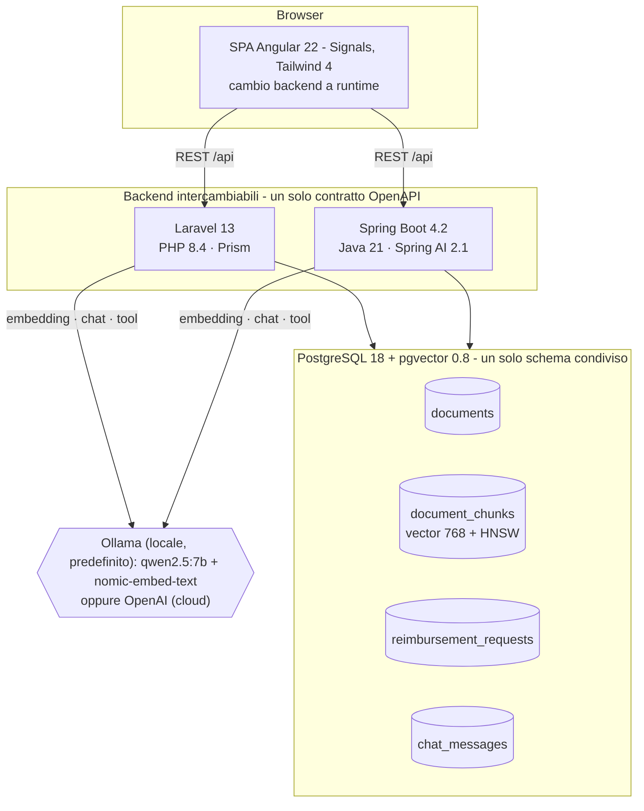
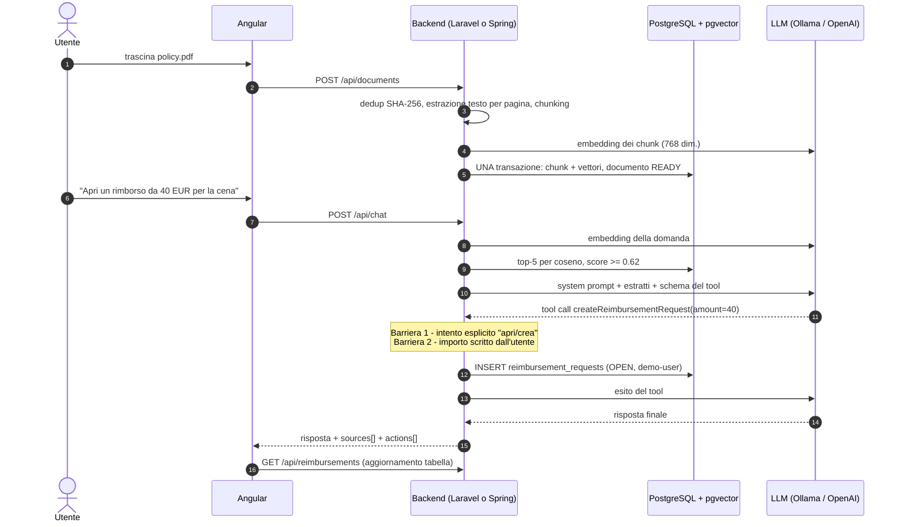

**[🇬🇧 Read in English](README.en.md)**

# Enterprise AI Assistant

[https://github.com/user-attachments/assets/fd6c4670-d545-4ca0-865a-21a9a61aae20](https://github.com/user-attachments/assets/1634dc6b-77cb-4de9-973e-66fcf13ce5a9)

**Un sistema multi-backend di RAG e azioni agentiche.** Un unico frontend Angular 22 dialoga con **due backend intercambiabili** — **Laravel 13 (PHP)** e **Spring Boot 4 + Spring AI 2.1 (Java)** — che implementano lo *stesso* contratto API sopra lo *stesso* database PostgreSQL + pgvector. Carichi un PDF di policy, fai domande e ottieni **risposte con citazioni a livello di pagina**, oppure chiedi all'assistente di **compiere un'azione** ("apri un rimborso da 40 € per la cena") — in sicurezza.

Lo scopo del progetto è architetturale: lo stesso problema di IA non banale risolto in due stack enterprise diffusi, vincolati a un unico contratto OpenAPI, a un indice vettoriale condiviso e a un modello di sicurezza condiviso — così da poterli confrontare in modo equo e scambiarli a runtime dalla UI.

**Come è stato sviluppato.** Il progetto è stato realizzato con l'assistenza di Claude Code (Anthropic). Requisiti, scelte di architettura, regole di sicurezza e verifica dei risultati sono a cura dell'autore; ogni decisione è documentata in [`docs/PROJECT_LOG.md`](docs/PROJECT_LOG.md).

---

## Indice

- [Cosa fa](#cosa-fa)
- [Architettura](#architettura)
- [Decisioni architetturali chiave](#decisioni-architetturali-chiave)
- [PHP/Laravel vs Java/Spring Boot](#phplaravel-vs-javaspring-boot)
- [Quickstart](#quickstart)
- [Struttura del repository](#struttura-del-repository)
- [Qualità e verifica](#qualità-e-verifica)
- [Limiti noti e prossimi passi](#limiti-noti-e-prossimi-passi)
- [Documentazione](#documentazione)

---

## Cosa fa

| | |
|---|---|
| **Ingestione** | Trascini un PDF → il testo viene estratto pagina per pagina, diviso in chunk da ~500 token, trasformato in embedding (768 dimensioni) e salvato in pgvector. I duplicati si riconoscono con lo SHA-256 (`409`). |
| **Domande (RAG)** | Le domande trovano risposta *solo* dagli estratti recuperati, con citazioni `[file.pdf, p. N]` e badge delle fonti cliccabili. Se i documenti non contengono la risposta, l'assistente lo dice. |
| **Azioni (tool calling)** | Due tool. "Apri un rimborso da 40 € per la cena" fa chiamare al modello `createReimbursementRequest`; "Segna come eseguito il rimborso #2" / "Approva il rimborso della cena" chiama `updateReimbursementStatus` (approvato, rifiutato, eseguito). Entrambi scrivono su PostgreSQL e la tabella nella UI — con un badge colorato per stato (*In attesa, Approvato, Rifiutato, Eseguito*) — si aggiorna da sola. |
| **Cambio backend dal vivo** | Un selettore nell'intestazione sposta tutta la UI tra Laravel (`:8000`) e Spring Boot (`:8080`) a runtime — stessi dati, stesso indice, stessa conversazione. |

Di default tutto gira in locale (Ollama + `qwen2.5:7b` + `nomic-embed-text`); OpenAI è un interruttore di configurazione.

---

## Architettura



Un turno di chat che include un'azione, dall'inizio alla fine:



---

## Decisioni architetturali chiave

### 1. Un solo indice vettoriale condiviso da PHP e Java

Lo schema vive in **un unico posto**, [`db/init/01-init.sql`](db/init/01-init.sql). Nessuno dei due backend ne è proprietario: Hibernate gira con `ddl-auto: none` e le migration di Laravel sono idempotenti (non fanno nulla se le tabelle esistono già). Un database creato prima della funzione sugli stati viene aggiornato sul posto da una migrazione idempotente (`reimbursement_requests.number`, l'identità `#1, #2…` e lo stato `EXECUTED`) — Laravel la esegue con `migrate`, Spring Boot con `spring.sql.init`; i dati restano.

Il `PgVectorStore` standard di Spring AI crea una tabella *propria*, e questo avrebbe reso ogni PDF indicizzato da un backend invisibile all'altro. Invece `DocumentChunkVectorStore` implementa direttamente l'interfaccia `VectorStore` di Spring AI sopra la tabella condivisa `document_chunks`: il codice Java usa l'API standard (`add`, `upsert`, `similaritySearch`, `SearchRequest`, espressioni di filtro) mentre PHP legge e scrive le stesse identiche righe.

**Risultato:** un PDF caricato tramite Laravel riceve risposta da Spring Boot con la *stessa fonte e lo stesso score di similarità* (0,8425 nella prova di riferimento), e una conversazione iniziata su un backend prosegue sull'altro (anche `chat_messages` è condivisa). Il retrieval usa la similarità coseno (`<=>`) su un indice HNSW, con le scansioni iterative di pgvector 0.8 per le query filtrate. Le scritture sono atomiche: prima si calcolano tutti gli embedding, poi chunk e stato `READY` vengono salvati in un'unica transazione — un documento è completo oppure non c'è.

### 2. Due barriere di sicurezza sul tool calling

A un LLM che può scrivere su un database non si deve lasciare la decisione su *quando* farlo. Collaudando un modello reale da 3 miliardi di parametri, ha aperto un rimborso da 50 € in risposta a una semplice domanda sul limite delle cene (copiando il numero dai documenti) e uno da 200 € in risposta a *"Posso farmi rimborsare 200 € per una cena?"*. I prompt da soli non risolvono il problema, quindi le barriere sono **nel codice, indipendenti dal modello**, e identiche nei due backend:

1. **Barriera sul verbo esplicito** — l'ultimo messaggio dell'utente deve essere un vero *ordine* con un verbo esplicito: per creare un rimborso (*open, add, create, insert, register, request, send…* / *apri, aggiungi, crea, inserisci, registra, richiedi, invia…*) oppure per cambiare lo stato di uno esistente (*mark, approve, reject, execute, update, close…* / *segna, approva, rifiuta, esegui, aggiorna, chiudi…*). Le domande, le domande di permesso e le ipotesi (*"Posso farmi rimborsare 200 €?"*, *"A che punto è il rimborso #2?"*) non sono mai ordini. **Una frase che sembra un ordine ma non ha il verbo** (*"allora un rimborso per hotel da 120 euro"*, *"rimborso #2 eseguito"*) non esegue nulla e non interpella nemmeno il modello: la risposta dice all'utente quali verbi usare, con un esempio costruito sul suo messaggio, e la UI mostra un avviso ambra a video (campo `warning` della risposta della chat).
2. **Barriera sulla provenienza** — ciò su cui agisce il tool deve venire alla lettera dal messaggio dell'utente: l'importo per un nuovo rimborso; il `#numero` o la parola della descrizione per un cambio di stato. Nel cambio di stato il **nuovo stato lo decidono le parole dell'utente**, non il modello (*approva* → approvato, *rifiuta* → rifiutato, *esegui / segna come eseguito / paga / chiudi* → eseguito). Il modello non può mai prendere i valori dai documenti né inventarli.

Il cambio di stato passa anche da regole di business nel servizio: un numero inesistente, una parola che corrisponde a più rimborsi (*"Più rimborsi corrispondono a «cena»: #1, #3. Indica il numero"*), un rimborso già in quello stato o in uno stato finale (*eseguito* e *rifiutato* non si modificano più) vengono rifiutati con una spiegazione e non si cambia nulla.

Oltre a queste: un tetto lato server (10.000 €) imposto dal servizio **e** da un vincolo `CHECK` del database, richieste create sempre come `OPEN` (l'approvazione è umana), ogni esito del tool restituito al modello come semplice testo e output del modello mostrato nella UI solo come testo (mai `innerHTML`). Le citazioni che puntano a documenti mai recuperati vengono riconosciute e sostituite da un rifiuto onesto. Poiché i piccoli modelli a volte *raccontano* una chiamata al tool invece di farla — e poi annunciano un rimborso mai creato — nel codice ci sono altre due difese: una risposta che dichiara un successo quando non è stato salvato nulla viene sostituita da un messaggio onesto, e un ordine non ambiguo (un solo importo scritto dall'utente, oppure un cambio di stato con uno stato chiaro e un riferimento) viene eseguito dal backend stesso, attraverso lo stesso servizio protetto, se il modello non chiama il tool. Tutto questo è coperto da test automatici ed è stato provato con un modello reale.

### 3. IA local-first: Ollama, nativo o in Docker — oppure OpenAI

**Ollama (predefinito).** Nulla esce dal tuo computer. `docker compose --profile ollama up` avvia Ollama in un container e scarica i modelli. *Docker Desktop su macOS esegue i container solo su CPU*, quindi per la velocità conviene eseguire Ollama **in modo nativo** sul Mac (usa la GPU Apple) e puntare i container verso di lui:

```bash
brew install ollama            # oppure installa l'app Ollama
ollama pull qwen2.5:7b && ollama pull nomic-embed-text
OLLAMA_BASE_URL=http://host.docker.internal:11434 docker compose --profile laravel --profile springboot up -d --build
```

(In questo caso non passare `--profile ollama`.) Nelle prove di riferimento con Docker solo CPU, le risposte hanno richiesto da circa 7 a 200 s a seconda della dimensione del prompt.

**OpenAI / cloud.** Gli embedding vengono richiesti a 768 dimensioni, così lo stesso schema funziona.
- *Laravel:* in `backend-laravel/.env` imposta `AI_PROVIDER=openai`, `OPENAI_API_KEY`, `AI_CHAT_MODEL=gpt-4o-mini`, `AI_EMBEDDING_MODEL=text-embedding-3-small`.
- *Spring Boot:* in `application.yml` cambia `spring.ai.model.chat` / `.embedding` da `ollama` a `openai` e decommenta il blocco `openai` (è incluso un modello commentato), poi `export OPENAI_API_KEY=...` e ricostruisci con `--build`.

### Altre decisioni da guardare

| Decisione | Perché |
|---|---|
| **Contratto OpenAPI per primo** ([`docs/api/openapi.yaml`](docs/api/openapi.yaml)), errori RFC 9457 `problem+json` con tipi stabili `urn:eaa:error:*` | Il frontend dipende dal contratto, non da un backend. 15 risposte API e 6 scenari di upload reali sono stati confrontati fianco a fianco tra i due backend: identici. |
| **Comportamento RAG identico** — stesso file di prompt (un test fallisce se divergono), top-5, similarità ≥ 0,62, chunk da 500 token, stessa frase di rifiuto | Le risposte sono confrontabili tra gli stack. La soglia 0,62 è stata *calibrata su embedding reali* (pertinenti 0,64–0,84, fuori tema 0,53–0,61); il primo tentativo di 0,70 scartava domande legittime. |
| **Denaro come stringhe decimali** (`"50.00"`), date in ISO-8601 UTC senza frazioni | Niente arrotondamenti in virgola mobile, niente differenze di formato tra backend nella UI. |
| **Stato del frontend in store a Signals**, zoneless, protezione dalle risposte superate al cambio backend | I componenti restano sottili; cambiare backend durante una richiesta non può mostrare i dati del backend sbagliato. |
| **I test girano su PostgreSQL + pgvector reali**; l'LLM è simulato da un vero server HTTP locale | SQLite non ha il tipo `vector`; simulare al confine HTTP esercita comunque serializzazione, tool calling e percorsi d'errore reali. Le suite rifiutano di partire se il nome del DB non termina con `_test`. |

---

## PHP/Laravel vs Java/Spring Boot

Stesso contratto, stesso comportamento, stesso database — idiomi diversi. Le dimensioni sono misurate; le opinioni sono indicate come tali.

| Aspetto | **Laravel 13** (`backend-laravel`) | **Spring Boot 4.2** (`backend-springboot`) |
|---|---|---|
| Runtime | PHP 8.4 (serve ≥ 8.3) | Java 21, Tomcat embedded |
| Libreria di IA | **Prism** 0.103 (`Prism::text()`, `Prism::embeddings()`) | **Spring AI** 2.1 (`ChatClient`, `EmbeddingModel`) |
| PDF → testo | `smalot/pdfparser` 2.13, pagina per pagina | `PagePdfDocumentReader` (Apache PDFBox 3), pagina per pagina |
| Chunking | Splitter proprio: ~2000 caratteri ≈ 500 token (stimati), 200 caratteri di overlap, tagli sensibili alle frasi | `TokenTextSplitter`: **token reali** (JTokkit), 500 / overlap 50 — misurati 476–493 token per chunk |
| Accesso ai vettori | SQL diretto via `DB::select` + tipi `pgvector/pgvector` | Interfaccia `VectorStore` **implementata** sulla tabella condivisa (`JdbcClient`), espressioni di filtro di Spring AI |
| Definizione del tool | `Tool::as()->for()->using(closure)`, stato della richiesta catturato dalla closure | `@Bean @Description BiFunction` incapsulata in `FunctionToolCallback`; stato della richiesta via `ToolContext` |
| Persistenza | Eloquent (UUIDv7, cast degli enum, `decimal:2`) | JPA / Hibernate 7.4 (generatore UUIDv7) per documenti e rimborsi; `JdbcClient` per le righe JSONB della chat |
| Validazione ed errori | `FormRequest` + renderer delle eccezioni in `bootstrap/app.php` | Validazione manuale nei controller + `@RestControllerAdvice` |
| Configurazione | `.env` + `config/eaa.php` | `application.yml` + record `@ConfigurationProperties` |
| Cambio provider | `AI_PROVIDER` in `.env` | `spring.ai.model.*` in `application.yml` (entrambi gli starter nel classpath, tipi di modello inutilizzati disattivati) |
| Schema | Migration idempotenti (+ SQL di init condiviso) | SQL di init condiviso, `ddl-auto: none`; un piccolo script idempotente di aggiornamento (`spring.sql.init`) |
| Codice applicativo | ≈ 2,1 k righe (commenti inclusi) | ≈ 2,1 k righe (commenti inclusi) |
| Test automatici | **214** (PHPUnit, 1.478 asserzioni) | **97** (JUnit 5 + MockMvc) |
| Immagine container | 826 MB (immagine di sviluppo, sorgenti montati) | 803 MB (multi-stage, fat jar); l'app parte in ~4 s |
| Trappole incontrate | `artisan serve` ignora le variabili d'ambiente del container → usare `php -S`; i warning PHP nel corpo della risposta rovinano il JSON → `display_errors=Off` | Spring AI 2.x ha eliminato `toolNames()`; con entrambi gli starter nel classpath i tipi di modello inutilizzati vanno messi a `none`, altrimenti l'app non parte senza chiave API; Tomcat richiede `max-swallow-size` per rispondere `413` agli upload grandi |
| Giudizio onesto | Il più rapido per iterare; la parte di IA è uno strato sottile e leggibile | Più cerimonia, ma le astrazioni (`VectorStore`, tool callback, tokenizzatore reale) sono di prima classe e sostituibili |

---

## Quickstart

**Prerequisiti:** Docker (con ~8 GB di RAM a disposizione per il modello da 7B), Node ≥ 22.22 e npm. Nient'altro — PHP e Java girano nei container.

```bash
# 1. Infrastruttura: PostgreSQL+pgvector, Ollama (scarica ~5 GB di modelli una sola volta) e i due backend
docker compose --profile ollama --profile laravel --profile springboot up -d --build
docker compose logs -f ollama-pull          # attendi "success" due volte, poi Ctrl-C

# 2. Verifica che i due backend siano attivi
curl -s localhost:8000/up        >/dev/null && echo "Laravel OK"      # http://localhost:8000
curl -s localhost:8080/actuator/health      # {"status":"UP",...}    # http://localhost:8080

# 3. Frontend
cd frontend-angular
npm install
npm start                        # http://localhost:4200
```

Apri **http://localhost:4200**, trascina un PDF e usa i chip dei suggerimenti. Passa da **Laravel ⇄ Spring Boot** nell'intestazione quando vuoi. Il file di esempio [`backend-laravel/tests/Fixtures/policy_rimborsi.pdf`](backend-laravel/tests/Fixtures/policy_rimborsi.pdf) (limite cena 50 €, limite hotel 150 €) funziona con i chip integrati.

Ti serve un solo backend? Usa solo `--profile laravel` **oppure** `--profile springboot`. Ferma tutto con `docker compose --profile ollama --profile laravel --profile springboot down` (aggiungi `-v` per cancellare anche il database).

**Eseguire i test**

```bash
docker compose up -d postgres
docker compose exec postgres psql -U eaa -d eaa -c 'CREATE DATABASE eaa_test'          # una volta, per Laravel
docker compose run --rm -e RUN_MIGRATIONS=false backend-laravel php artisan test      # 214 test
(cd backend-springboot && ./mvnw test)                                                 # 97 test (crea il proprio DB)
(cd frontend-angular && npm test)                                                      # 69 test
```

**Prima del primo commit — assicurati che nessun segreto, dipendenza o file temporaneo sia tracciato**

```bash
git init && git add -A

# 1. Nulla di sensibile deve essere tracciato (stampa la riga OK quando l'elenco è vuoto)
git ls-files | grep -E '(^|/)\.env($|\.)|node_modules/|(^|/)vendor/|(^|/)target/|\.log$' | grep -v '\.env\.example$' \
  && echo "ATTENZIONE: controlla i file elencati sopra" \
  || echo "OK: nessun segreto, dipendenza o log è tracciato"

# 2. Si versiona solo il modello, il vero .env resta in locale
git ls-files | grep '\.env'                  # -> backend-laravel/.env.example   (e nient'altro)

# 3. Guarda cosa viene ignorato (dovresti trovare .env, vendor/, node_modules/, target/, dist/...)
git status --ignored --short | grep '^!!'
```

Il [`.gitignore`](.gitignore) della radice blocca `.env*` (tranne `.env.example`), file di chiavi, cartelle delle dipendenze, output di build, log, artefatti dei test e file di sistema/editor; anche ogni sottoprogetto mantiene il proprio.

---

## Struttura del repository

```
├── docker-compose.yml          PostgreSQL+pgvector · Ollama · backend (profili: ollama, laravel, springboot)
├── db/init/01-init.sql         LO schema (unica fonte di verità per entrambi i backend)
├── docs/
│   ├── api/openapi.yaml        Il contratto API implementato da entrambi i backend
│   └── PROJECT_LOG.md          Diario di progetto: ogni decisione, compromesso e bug trovato (in italiano)
├── frontend-angular/           Angular 22 · componenti standalone · Signals · Tailwind 4
├── backend-laravel/            Laravel 13 · Prism · pgvector
└── backend-springboot/         Spring Boot 4.2 · Spring AI 2.1 · Java 21
```

---

## Qualità e verifica

Cosa è stato davvero eseguito (non solo scritto):

- **380 test automatici** nelle tre app (214 + 97 + 69) — PostgreSQL + pgvector reali, LLM simulato.
- **Prove dal vivo con un modello locale reale** (`qwen2.5:7b`): ingestione, risposte con citazioni, tool calling e i casi di fallimento descritti sopra — ed è così che sono state trovate le barriere e la soglia di similarità.
- **Controlli di parità tra i backend:** 15 risposte API (dati + ogni errore di validazione/404/405) e 6 casi di upload reali (nessun file, `.txt`, eseguibile rinominato, PDF corrotto, 21 MB, 50 MB) confrontati tra `:8000` e `:8080` — identici.
- **End-to-end in un browser reale** (Playwright + Chromium, eseguito a mano, non incluso nel repository): drag & drop, indicatore di caricamento, badge delle fonti, aggiornamento automatico della tabella, cambio backend a runtime con persistenza in `localStorage`, stati d'errore, layout responsive fino a 360 px. Eseguito su entrambi i backend.

Non verificati: **OpenAI** (la configurazione è pronta; non è stata usata nessuna chiave), **Ollama nativo su macOS** (il percorso di rete container→host è stato verificato con un servizio di prova; Ollama non è installato sulla macchina di test) e qualsiasi corpus di documenti reali oltre ai PDF di esempio.

---

## Limiti noti e prossimi passi

Questa è un'architettura di riferimento, non un prodotto rinforzato. Volutamente fuori ambito: **autenticazione** (tutto gira come `demo-user`), **OCR** per i PDF scansionati (→ `422`), **ingestione asincrona** (l'indicizzazione è sincrona) e risposte in **streaming**. Note sul comportamento: i piccoli modelli locali non sono deterministici (le barriere rendono impossibili le azioni sbagliate, non la prosa sbagliata); una soglia di retrieval tarata su due pagine di esempio va ritarata su un corpus reale; le query molto brevi possono restare sotto soglia.

Prossimi passi naturali: autenticazione (`requested_by` e `user_id` sono già modellati), una coda di job per l'ingestione, streaming SSE, un percorso OCR, un test di parità tra i due backend incluso nel repository e un set di valutazione per la qualità del retrieval.

---

## Documentazione

- [`docs/PROJECT_LOG.md`](docs/PROJECT_LOG.md) — il diario di progetto completo: oltre 40 decisioni numerate con motivazioni, guide al codice per componente e ogni difetto trovato eseguendo davvero il sistema (in italiano).
- [`docs/api/openapi.yaml`](docs/api/openapi.yaml) — il contratto API.
- README delle singole app: [`frontend-angular`](frontend-angular/README.md) · [`backend-laravel`](backend-laravel/README.md) · [`backend-springboot`](backend-springboot/README.md).

---

© Tutti i diritti riservati. Questo repository è fornito solo per consultazione e valutazione; non viene concessa alcuna licenza open source.
