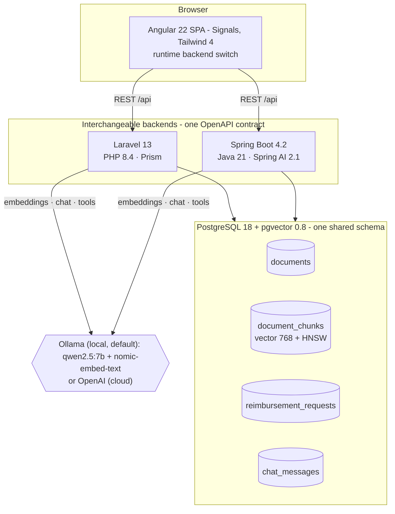
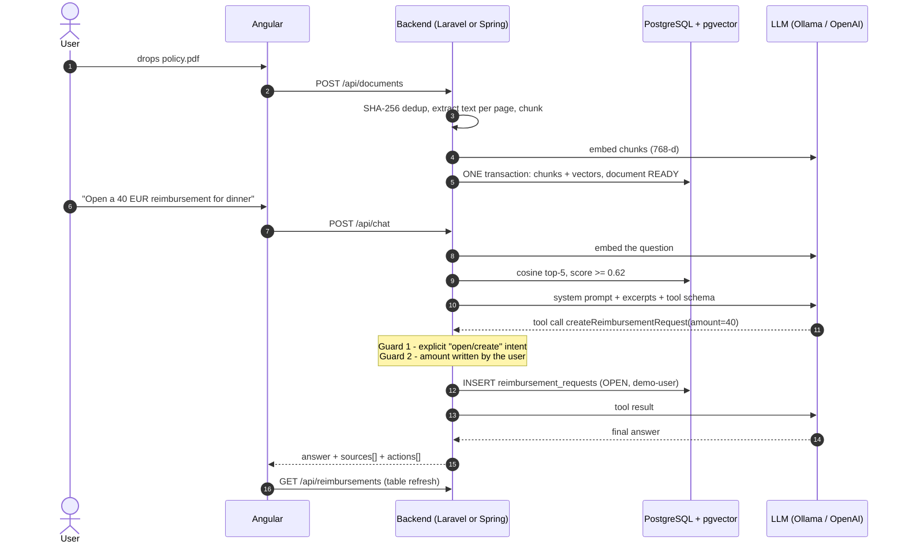

# Enterprise AI Assistant


**A multi-backend RAG & agentic-action system.** One Angular 22 frontend talks to **two interchangeable backends** — **Laravel 13 (PHP)** and **Spring Boot 4 + Spring AI 2.1 (Java)** — that implement the *same* API contract on top of the *same* PostgreSQL + pgvector database. Upload a policy PDF, ask questions and get **answers with page-level citations**, or ask the assistant to **take an action** ("open a €40 dinner reimbursement") — safely.

The point of the project is architectural: the same non-trivial AI problem solved in two mainstream enterprise stacks, held to a single OpenAPI contract, a shared vector index and a shared safety model — so the two can be compared fairly and swapped at runtime from the UI.

---

## Table of contents

- [What it does](#what-it-does)
- [Architecture](#architecture)
- [Key architectural decisions](#key-architectural-decisions)
- [PHP/Laravel vs Java/Spring Boot](#phplaravel-vs-javaspring-boot)
- [Quickstart](#quickstart)
- [Repository layout](#repository-layout)
- [Quality & verification](#quality--verification)
- [Known limits & next steps](#known-limits--next-steps)
- [Documentation](#documentation)

---

## What it does

| | |
|---|---|
| **Ingest** | Drag & drop a PDF → text is extracted page by page, split into ~500-token chunks, embedded (768-d) and stored in pgvector. Duplicates are detected by SHA-256 (`409`). |
| **Ask (RAG)** | Questions are answered *only* from retrieved excerpts, with `[file.pdf, p. N]` citations and clickable source badges. If the documents don't contain the answer, the assistant says so. |
| **Act (tool calling)** | "Open a €40 dinner reimbursement" makes the model call a `createReimbursementRequest` tool that writes to PostgreSQL. The reimbursements table in the UI refreshes by itself. |
| **Switch backend live** | A selector in the header flips the whole UI between Laravel (`:8000`) and Spring Boot (`:8080`) at runtime — same data, same index, same conversation. |

Everything runs locally by default (Ollama + `qwen2.5:7b` + `nomic-embed-text`); OpenAI is a configuration switch.

---

## Architecture



One chat turn that includes an action, end to end:



---

## Key architectural decisions

### 1. One vector index shared by PHP and Java

The schema lives in **one place**, [`db/init/01-init.sql`](db/init/01-init.sql). Neither backend owns it: Hibernate runs with `ddl-auto: none`, and the Laravel migrations are idempotent (they no-op when the tables exist).

Spring AI's stock `PgVectorStore` creates its *own* table, which would have made every PDF indexed by one backend invisible to the other. Instead, `DocumentChunkVectorStore` implements Spring AI's `VectorStore` interface directly on top of the shared `document_chunks` table — so the Java code uses the standard API (`add`, `upsert`, `similaritySearch`, `SearchRequest`, filter expressions) while PHP reads and writes the very same rows.

**Result:** a PDF uploaded through Laravel is answered by Spring Boot with the *same source and the same similarity score* (0.8425 in the reference run), and a conversation started on one backend continues on the other (`chat_messages` is shared too). Retrieval is cosine similarity (`<=>`) on an HNSW index, with pgvector 0.8 iterative scans for filtered queries. Writes are atomic: all embeddings are computed first, then chunks and the `READY` status are committed in one transaction — a document is complete or absent.

### 2. Two safety guardrails on tool calling

An LLM that can write to a database must not be trusted to decide *when*. While testing against a real 3B-parameter model, it opened a €50 reimbursement in response to a plain question about the dinner limit (copying the number from the documents), and a €200 one in response to *"Can I get €200 reimbursed for a dinner?"*. Prompts alone don't fix that, so the guardrails are **in code, independent of the model**, and identical in both backends:

1. **Explicit-intent guard** — the user's latest message must contain an opening verb (*open, create, register, submit…* / *apri, crea, registra, invia…*). A question is not an order.
2. **Amount-provenance guard** — the amount passed to the tool must literally appear in the user's own messages. The model may never take it from the documents or invent it.

On top of those: a server-side cap (€10,000) enforced in the service **and** by a database `CHECK` constraint, requests always created as `OPEN` (a human approves), every tool outcome returned to the model as plain text, and the model's output rendered in the UI as text only (never `innerHTML`). Citations pointing at documents that were never retrieved are detected and replaced by an honest refusal. All of this is covered by automated tests and was exercised with a real model.

### 3. Local-first AI: Ollama, native or in Docker — or OpenAI

**Ollama (default).** Nothing leaves your machine. `docker compose --profile ollama up` runs Ollama in a container and pulls the models. *Docker Desktop on macOS runs containers CPU-only*, so for speed run Ollama **natively** on the Mac (it uses the Apple GPU) and point the containers at it:

```bash
brew install ollama            # or install the Ollama app
ollama pull qwen2.5:7b && ollama pull nomic-embed-text
OLLAMA_BASE_URL=http://host.docker.internal:11434 docker compose --profile laravel --profile springboot up -d --build
```

(Don't pass `--profile ollama` in that case.) In the reference runs on CPU-only Docker, answers took roughly 7–200 s depending on prompt size.

**OpenAI / cloud.** Embeddings are requested at 768 dimensions so the same schema works.
- *Laravel:* in `backend-laravel/.env` set `AI_PROVIDER=openai`, `OPENAI_API_KEY`, `AI_CHAT_MODEL=gpt-4o-mini`, `AI_EMBEDDING_MODEL=text-embedding-3-small`.
- *Spring Boot:* in `application.yml` switch `spring.ai.model.chat` / `.embedding` from `ollama` to `openai` and uncomment the `openai` block (a commented template is included), then `export OPENAI_API_KEY=...` and rebuild with `--build`.

### Other decisions worth a look

| Decision | Why |
|---|---|
| **OpenAPI contract first** ([`docs/api/openapi.yaml`](docs/api/openapi.yaml)), RFC 9457 `problem+json` errors with stable `urn:eaa:error:*` types | The frontend depends on the contract, not on a backend. 15 API responses and 6 real upload scenarios were compared side by side across the two backends: identical. |
| **Identical RAG behaviour** — same prompt file (a test fails if they diverge), top-5, similarity ≥ 0.62, 500-token chunks, same refusal sentence | Answers are comparable across stacks. The 0.62 threshold was *calibrated on real embeddings* (relevant 0.64–0.84, off-topic 0.53–0.61); the first guess of 0.70 rejected legitimate questions. |
| **Money as decimal strings** (`"50.00"`), dates as ISO-8601 UTC without fractions | No float rounding, no per-backend formatting drift in the UI. |
| **Frontend state in Signals stores**, zoneless, stale-response guards on backend switch | Components stay thin; switching backends mid-request can't show the wrong backend's data. |
| **Tests run on real PostgreSQL + pgvector**; the LLM is faked by a real local HTTP server | SQLite has no `vector` type; faking at the HTTP edge still exercises real serialization, tool calling and error paths. Test suites refuse to run unless the DB name ends in `_test`. |

---

## PHP/Laravel vs Java/Spring Boot

Same contract, same behaviour, same database — different idioms. Sizes are measured; opinions are marked.

| Concern | **Laravel 13** (`backend-laravel`) | **Spring Boot 4.2** (`backend-springboot`) |
|---|---|---|
| Runtime | PHP 8.4 (needs ≥ 8.3) | Java 21, embedded Tomcat |
| AI library | **Prism** 0.103 (`Prism::text()`, `Prism::embeddings()`) | **Spring AI** 2.1 (`ChatClient`, `EmbeddingModel`) |
| PDF → text | `smalot/pdfparser` 2.13, page by page | `PagePdfDocumentReader` (Apache PDFBox 3), page by page |
| Chunking | Own splitter: ~2000 chars ≈ 500 tokens (estimated), 200-char overlap, sentence-aware cuts | `TokenTextSplitter`: **real tokens** (JTokkit), 500 / overlap 50 — measured 476–493 tokens per chunk |
| Vector access | Raw SQL via `DB::select` + `pgvector/pgvector` types | `VectorStore` **interface implemented** on the shared table (`JdbcClient`), Spring AI filter expressions |
| Tool definition | `Tool::as()->for()->using(closure)`, per-request state captured by the closure | `@Bean @Description BiFunction` wrapped in `FunctionToolCallback`; per-request state via `ToolContext` |
| Persistence | Eloquent (UUIDv7, enum casts, `decimal:2`) | JPA / Hibernate 7.4 (UUIDv7 generator) for documents & refunds; `JdbcClient` for JSONB chat rows |
| Validation & errors | `FormRequest` + exception renderers in `bootstrap/app.php` | Manual validation in controllers + `@RestControllerAdvice` |
| Config | `.env` + `config/eaa.php` | `application.yml` + `@ConfigurationProperties` records |
| Provider switch | `AI_PROVIDER` in `.env` | `spring.ai.model.*` in `application.yml` (both starters on classpath, unused model types disabled) |
| Schema | Idempotent migrations (+ shared init SQL) | None — shared init SQL, `ddl-auto: none` |
| Application code | ≈ 2.1 k lines (comments included) | ≈ 2.1 k lines (comments included) |
| Automated tests | **52** (PHPUnit, 1 188 assertions) | **67** (JUnit 5 + MockMvc) |
| Container image | 826 MB (dev image, bind-mounted source) | 803 MB (multi-stage, fat jar); app starts in ~4 s |
| Gotchas hit | `artisan serve` ignores the container's env vars → use `php -S`; PHP warnings in the response body corrupt JSON → `display_errors=Off` | Spring AI 2.x dropped `toolNames()`; both starters on the classpath need unused model types set to `none` or the app won't boot without an API key; Tomcat needs `max-swallow-size` to return `413` on large uploads |
| Honest take | Quickest to iterate; the AI part is a thin, readable layer | More ceremony, but the abstractions (`VectorStore`, tool callbacks, real tokenizer) are first-class and swappable |

---

## Quickstart

**Prerequisites:** Docker (with ~8 GB RAM available to it for the 7B model), Node ≥ 22.22 and npm. Nothing else — PHP and Java run in containers.

```bash
# 1. Infrastructure: PostgreSQL+pgvector, Ollama (pulls ~5 GB of models once), and both backends
docker compose --profile ollama --profile laravel --profile springboot up -d --build
docker compose logs -f ollama-pull          # wait for "success" twice, then Ctrl-C

# 2. Check both backends are up
curl -s localhost:8000/up        >/dev/null && echo "Laravel OK"      # http://localhost:8000
curl -s localhost:8080/actuator/health      # {"status":"UP",...}    # http://localhost:8080

# 3. Frontend
cd frontend-angular
npm install
npm start                        # http://localhost:4200
```

Open **http://localhost:4200**, drop a PDF, and use the suggestion chips. Flip **Laravel ⇄ Spring Boot** in the header at any time. The sample file [`backend-laravel/tests/Fixtures/policy_rimborsi.pdf`](backend-laravel/tests/Fixtures/policy_rimborsi.pdf) (dinner limit €50, hotel limit €150) works with the built-in chips.

Only one backend? Use just `--profile laravel` **or** `--profile springboot`. Stop everything with `docker compose --profile ollama --profile laravel --profile springboot down` (add `-v` to also delete the database).

**Run the tests**

```bash
docker compose up -d postgres
docker compose exec postgres psql -U eaa -d eaa -c 'CREATE DATABASE eaa_test'          # once, for Laravel
docker compose run --rm -e RUN_MIGRATIONS=false backend-laravel php artisan test      # 52 tests
(cd backend-springboot && ./mvnw test)                                                 # 67 tests (creates its own DB)
(cd frontend-angular && npm test)                                                      # 64 tests
```

**Before your first commit — make sure no secrets, dependencies or temp files are tracked**

```bash
git init && git add -A

# 1. Nothing sensitive may be tracked (prints the OK line when the list is empty)
git ls-files | grep -E '(^|/)\.env($|\.)|node_modules/|(^|/)vendor/|(^|/)target/|\.log$' | grep -v '\.env\.example$' \
  && echo "WARNING: review the files listed above" \
  || echo "OK: no secrets, dependencies or logs are tracked"

# 2. Only the template is versioned, the real .env stays local
git ls-files | grep '\.env'                  # -> backend-laravel/.env.example   (and nothing else)

# 3. See what is being ignored (you should find the .env, vendor/, node_modules/, target/, dist/...)
git status --ignored --short | grep '^!!'
```

The root [`.gitignore`](.gitignore) blocks `.env*` (except `.env.example`), key files, dependency folders, build output, logs, test artefacts and OS/editor files; each sub-project also keeps its own.

---

## Repository layout

```
├── docker-compose.yml          PostgreSQL+pgvector · Ollama · backends (profiles: ollama, laravel, springboot)
├── db/init/01-init.sql         THE schema (single source of truth for both backends)
├── docs/
│   ├── api/openapi.yaml        The API contract both backends implement
│   └── PROJECT_LOG.md          Engineering log: every decision, trade-off and bug found (in Italian)
├── frontend-angular/           Angular 22 · standalone components · Signals · Tailwind 4
├── backend-laravel/            Laravel 13 · Prism · pgvector
└── backend-springboot/         Spring Boot 4.2 · Spring AI 2.1 · Java 21
```

---

## Quality & verification

What was actually run (not just written):

- **183 automated tests** across the three apps (52 + 67 + 64) — real PostgreSQL + pgvector, faked LLM.
- **Live runs against a real local model** (`qwen2.5:7b`): ingestion, cited answers, tool calling, and the failure modes above — which is how the guardrails and the similarity threshold were found.
- **Cross-backend parity checks:** 15 API responses (data + every validation/404/405 error) and 6 real upload cases (no file, `.txt`, renamed executable, corrupt PDF, 21 MB, 50 MB) compared between `:8000` and `:8080` — identical.
- **Real-browser end-to-end** (Playwright + Chromium, run manually, not committed): drag & drop, loading indicator, source badges, table auto-refresh, runtime backend switch with `localStorage` persistence, error states, responsive layout down to 360 px. Run against both backends.

Not verified: **OpenAI** (configuration is in place; no key was used), **native Ollama on macOS** (the container→host network path was verified with a stand-in listener; Ollama itself isn't installed on the test machine), and any real-world document corpus beyond the sample PDFs.

---

## Known limits & next steps

This is a reference architecture, not a hardened product. Deliberately out of scope: **authentication** (everything runs as `demo-user`), **OCR** for scanned PDFs (→ `422`), **asynchronous ingestion** (indexing is synchronous), **streaming** responses. Behavioural notes: small local models are non-deterministic (the guardrails make wrong actions impossible, not wrong prose); a retrieval threshold tuned on two sample pages should be re-tuned on a real corpus; very short queries can score under the threshold.

Natural next steps: auth (`requested_by` and `user_id` are already modelled), a job queue for ingestion, SSE streaming, an OCR path, a committed parity test between the two backends, and an eval set for retrieval quality.

---

## Documentation

- [`docs/PROJECT_LOG.md`](docs/PROJECT_LOG.md) — the full engineering log: 40+ numbered decisions with rationale, per-component code guides, and every defect found by running the system for real (Italian).
- [`docs/api/openapi.yaml`](docs/api/openapi.yaml) — the API contract.
- Per-app READMEs: [`frontend-angular`](frontend-angular/README.md) · [`backend-laravel`](backend-laravel/README.md) · [`backend-springboot`](backend-springboot/README.md).

---

© All rights reserved. This repository is provided for viewing and evaluation only; no open-source license is granted.
